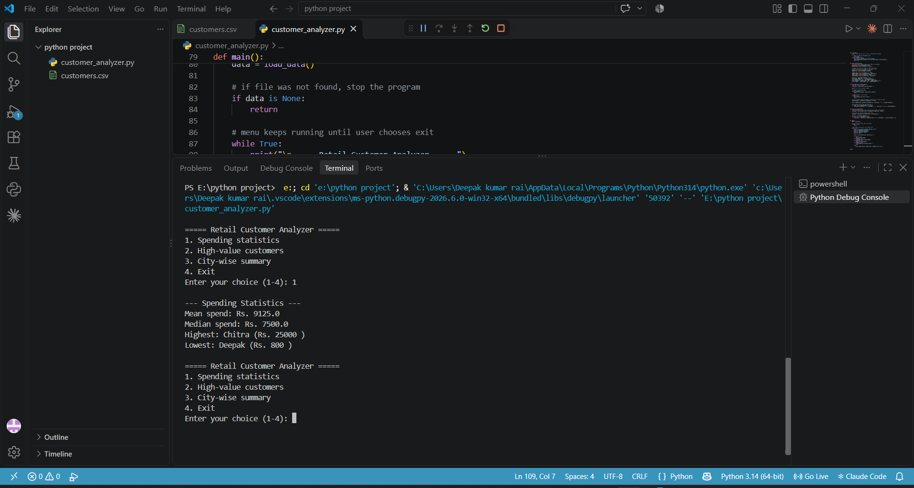
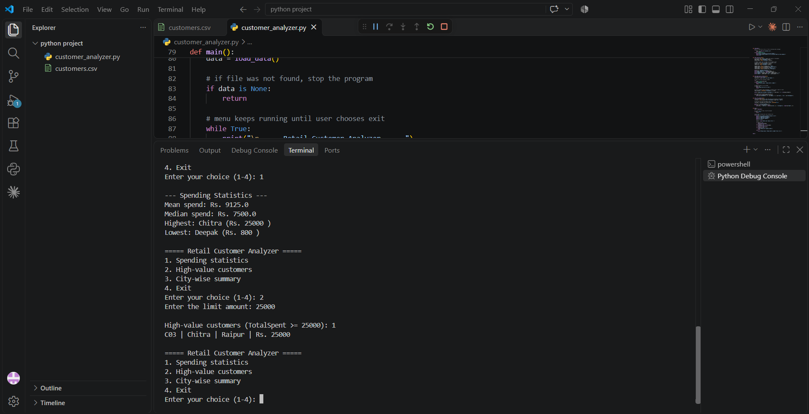
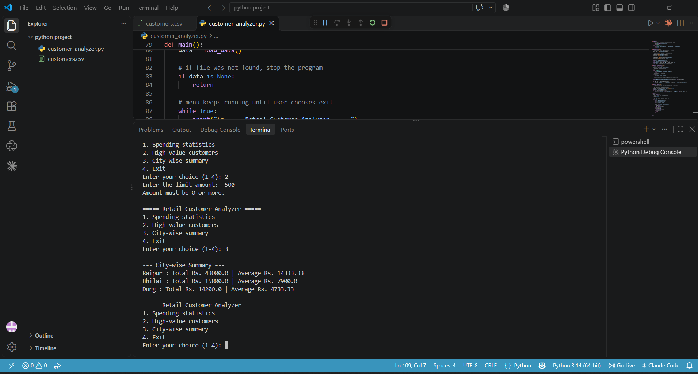

# Retail Customer Analyzer

## About the Project
This is a Python program that reads customer data from a CSV file using Pandas
and shows spending statistics, high-value customers and a city-wise summary.

## Student Details
- **Name:** Deepak Kumar Rai
- **Enrollment No:** RU-26-01558
- **Course:** B.Tech Computer Science and Engineering (1st Semester)
- **University:** Rungta International Skills University

  ## Technologies Used
- Python 3
- Pandas

## Features
1. Loads `customers.csv` and handles the missing file error
2. Shows mean, median, highest and lowest spending
3. Lists customers whose TotalSpent is at least the limit entered by the user
4. Shows city-wise total and average spending
5. Handles invalid input (text or negative numbers)

## Files in this Repository
| File | Description |
|---|---|
| `customer_analyzer.py` | Main Python program |
| `customers.csv` | Sample data (8 customers) |
| `screenshots/` | Screenshots of all 4 test cases |

## How to Run
1. Install Python 3 from python.org
2. Install Pandas:
   ```
   pip install pandas
   ```
3. Keep `customer_analyzer.py` and `customers.csv` in the same folder
4. Run the program:
   ```
   python customer_analyzer.py
   ```
5. Choose an option from the menu (1 to 4)


## Test Cases
| Test Case | Input | Result |
|---|---|---|
| 1. Normal | Spending statistics | Passed |
| 2. Boundary | Limit = 25000 | Passed |
| 3. Invalid | Limit = abc / -500 | Passed |
| 4. Different valid | City-wise summary | Passed |


## Project Output

### 1. Spending Statistics


### 2. High-value Coustmers


### 3. Invalid Input
.png)
.png)

### 4. City-wise summary

